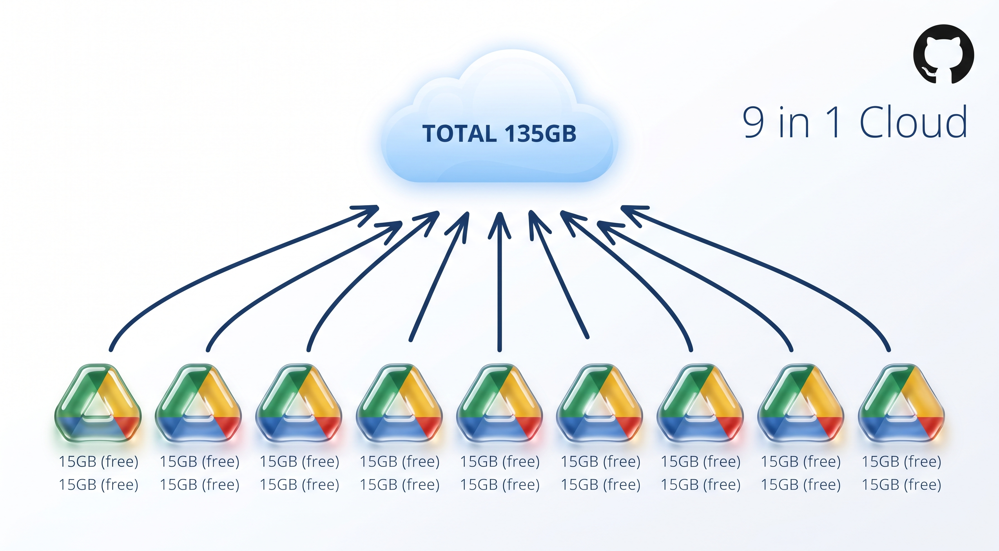
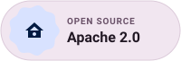
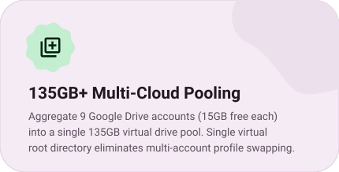
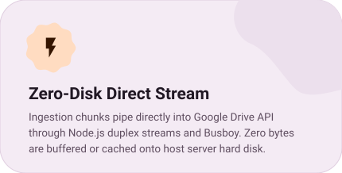
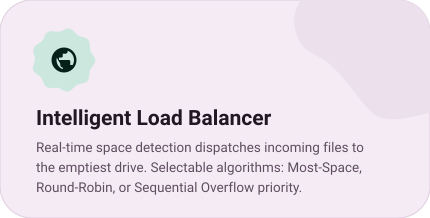
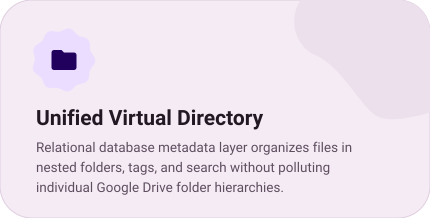
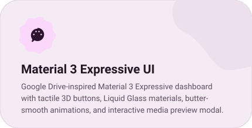
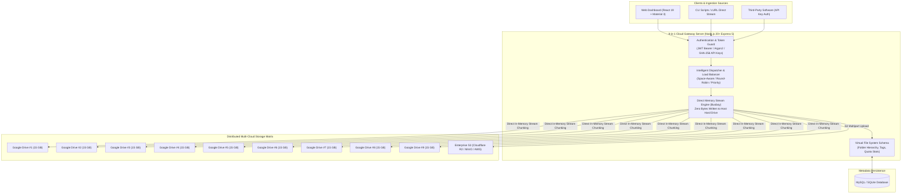
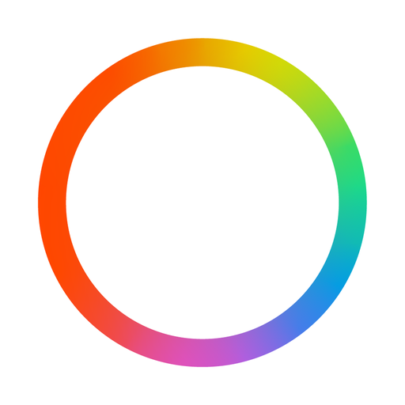

<div align="center">

# ⚡ 9-in-1 Cloud Storage Gateway

**The Unified Multi-Cloud Storage Pooling & Intelligent Stream Gateway**

*Aggregate up to 9 Google Drive & S3 cloud accounts into one seamless, high-performance virtual storage pool with zero server disk buffering.*

<br/>



<br><br>

<p align="center">
  <a href="https://smartworldarafath.github.io/9-in-1-Cloud/"><picture><source media="(prefers-color-scheme: dark)" srcset="assets/readme/dark/btn-launch.svg"></picture></a>
  <a href="https://github.com/smartworldarafath/9-in-1-Cloud"><picture><source media="(prefers-color-scheme: dark)" srcset="assets/readme/dark/btn-github.svg"></picture></a>
  <a href="#support"><picture><source media="(prefers-color-scheme: dark)" srcset="assets/readme/dark/btn-support.svg"></picture></a>
  <a href="#quickstart"><picture><source media="(prefers-color-scheme: dark)" srcset="assets/readme/dark/btn-docker.svg"></picture></a>
</p>

<p align="center">
  <a href="#overview" title="135 GB+ Virtual Storage Pool"><picture><source media="(prefers-color-scheme: dark)" srcset="assets/readme/dark/badge-pooling.svg"></picture></a>
  <a href="#architecture" title="Zero Server Disk Buffering"><picture><source media="(prefers-color-scheme: dark)" srcset="assets/readme/dark/badge-zerodisk.svg"></picture></a>
  <a href="https://nodejs.org" target="_blank" rel="noopener noreferrer" title="Node.js 20+ LTS Runtime"><picture><source media="(prefers-color-scheme: dark)" srcset="assets/readme/dark/badge-nodejs.svg"></picture></a>
  <a href="https://expressjs.com" target="_blank" rel="noopener noreferrer" title="Express 5 Gateway"><picture><source media="(prefers-color-scheme: dark)" srcset="assets/readme/dark/badge-express.svg"></picture></a>
  <a href="https://react.dev" target="_blank" rel="noopener noreferrer" title="React 19 Frontend Dashboard"><picture><source media="(prefers-color-scheme: dark)" srcset="assets/readme/dark/badge-react.svg"></picture></a>
  <a href="#features" title="9x Google Drive Accounts (15GB each)"><picture><source media="(prefers-color-scheme: dark)" srcset="assets/readme/dark/badge-gdrive.svg"></picture></a>
  <a href="#features" title="S3 & Cloudflare R2 Compatible"><picture><source media="(prefers-color-scheme: dark)" srcset="assets/readme/dark/badge-s3.svg"></picture></a>
  <a href="#quickstart" title="Docker Container Ready"><picture><source media="(prefers-color-scheme: dark)" srcset="assets/readme/dark/badge-docker.svg"></picture></a>
  <a href="LICENSE" title="Apache 2.0 Open Source License"><picture><source media="(prefers-color-scheme: dark)" srcset="assets/readme/dark/badge-license.svg"></picture></a>
  <a href="https://github.com/smartworldarafath/9-in-1-Cloud/pulls" title="Pull Requests Welcome!"><picture><source media="(prefers-color-scheme: dark)" srcset="assets/readme/dark/badge-prs.svg"></picture></a>
</p>

</div>

<h3 id="overview"><picture><source media="(prefers-color-scheme: dark) and (max-width: 640px)" srcset="assets/readme/dark/hm-overview.svg"><source media="(prefers-color-scheme: dark)" srcset="assets/readme/dark/h-overview.svg"><source media="(max-width: 640px)" srcset="assets/readme/light/hm-overview.svg"></picture></h3>

**9-in-1 Cloud** is a specialized, open-source **reverse-proxy storage gateway and virtualization layer** built for developers, homelab operators, and power users. It connects and aggregates up to **9 Google Drive accounts** (15 GB each = 135.00 GB free) plus enterprise S3 buckets (Cloudflare R2, MinIO, Wasabi, or AWS S3) into a single unified virtual storage pool with zero server disk buffering.

### ⚡ The Problem Solved
Managing multiple cloud accounts usually requires juggling browser profiles, switching accounts, and dealing with storage imbalances where one drive sits empty while another overflows. Typical VPS gateway solutions write entire files onto the host disk before uploading to cloud storage, risking disk exhaustion, slow I/O bottlenecks, and VPS failure.

### 🚀 The 9-in-1 Cloud Solution
1. **135 GB+ Free Unified Pool**: Immediately unites 9 free Google Drive accounts into a single massive 135 GB virtual storage pool.
2. **Zero-Buffering Direct Stream**: Files pipe directly from the client socket through Node.js stream buffers into Google Drive API v3 without writing a single byte to the VPS server hard drive.
3. **Dynamic Load Balancing**: Real-time quota detection automatically routes incoming files to the account with the most remaining space.
4. **Relational Virtual Directory**: A single unified MySQL or SQLite virtual file system hierarchy gives you complete folder trees, tags, search, and instant shareable streaming links.

<div align="center">
  <a href="https://smartworldarafath.github.io/9-in-1-Cloud/"><picture><source media="(prefers-color-scheme: dark)" srcset="assets/readme/dark/btn-launch.svg"></picture></a>
  <a href="https://github.com/smartworldarafath/9-in-1-Cloud/pulls"><picture><source media="(prefers-color-scheme: dark)" srcset="assets/readme/dark/btn-contribute.svg"></picture></a>
  <a href="LICENSE"><picture><source media="(prefers-color-scheme: dark)" srcset="assets/readme/dark/btn-license.svg"></picture></a>
</div>

<h3 id="features"><picture><source media="(prefers-color-scheme: dark) and (max-width: 640px)" srcset="assets/readme/dark/hm-features.svg"><source media="(prefers-color-scheme: dark)" srcset="assets/readme/dark/h-features.svg"><source media="(max-width: 640px)" srcset="assets/readme/light/hm-features.svg"></picture></h3>

<div align="center">

| | |
|:---:|:---:|
| <a href="#pooling" title="135GB+ Multi-Cloud Pooling"><picture><source media="(prefers-color-scheme: dark)" srcset="assets/readme/dark/card-pooling.svg"></picture></a> | <a href="#streaming" title="Zero-Disk Direct Stream"><picture><source media="(prefers-color-scheme: dark)" srcset="assets/readme/dark/card-stream.svg"></picture></a> |
| <a href="#balancer" title="Intelligent Load Balancer"><picture><source media="(prefers-color-scheme: dark)" srcset="assets/readme/dark/card-balancer.svg"></picture></a> | <a href="#vfs" title="Unified Virtual Directory"><picture><source media="(prefers-color-scheme: dark)" srcset="assets/readme/dark/card-vfs.svg"></picture></a> |
| <a href="#s3" title="S3 & Cloudflare R2 Tiering"><picture><source media="(prefers-color-scheme: dark)" srcset="assets/readme/dark/card-s3.svg"></picture></a> | <a href="#security" title="Enterprise Encryption & Auth"><picture><source media="(prefers-color-scheme: dark)" srcset="assets/readme/dark/card-security.svg"></picture></a> |
| <a href="#ui" title="Material 3 Expressive UI"><picture><source media="(prefers-color-scheme: dark)" srcset="assets/readme/dark/card-ui.svg"></picture></a> | <a href="#docker" title="100% Self-Hosted & Docker"><picture><source media="(prefers-color-scheme: dark)" srcset="assets/readme/dark/card-docker.svg"></picture></a> |

</div>

<h3 id="architecture"><picture><source media="(prefers-color-scheme: dark) and (max-width: 640px)" srcset="assets/readme/dark/hm-architecture.svg"><source media="(prefers-color-scheme: dark)" srcset="assets/readme/dark/h-architecture.svg"><source media="(max-width: 640px)" srcset="assets/readme/light/hm-architecture.svg"></picture></h3>



#### 🌊 The Stream Pipeline Lifecycle:
1. Client issues a `POST /files/upload` multipart stream.
2. Express pipes request chunks into `Busboy` on the fly.
3. The **Intelligent Dispatcher** queries remaining capacities across all 9 connected accounts.
4. An active OAuth2 client is retrieved (refreshing access tokens automatically if near expiration).
5. File chunks pipe directly into Google Drive API v3 `drive.files.create({ media: { body: fileStream } })`.
6. **Zero bytes of the uploaded file are saved to the server's local hard drive.** The file streams straight from the client socket into Google's cloud servers.
7. Upon completion, Google returns the remote file ID and size, which is recorded in the MySQL VFS metadata layer.

<h3 id="screenshots"><picture><source media="(prefers-color-scheme: dark) and (max-width: 640px)" srcset="assets/readme/dark/hm-screenshots.svg"><source media="(prefers-color-scheme: dark)" srcset="assets/readme/dark/h-screenshots.svg"><source media="(max-width: 640px)" srcset="assets/readme/light/hm-screenshots.svg"></picture></h3>

<div align="center">

<table width="100%">
  <tr>
    <td width="50%" align="center" valign="top">
      <br><br>
      <b>📊 Real-Time Quota Tracker & Space Matrix</b><br>
      <sub>Track combined 135 GB storage meters, individual drive capacities, and real-time distribution stats.</sub>
    </td>
    <td width="50%" align="center" valign="top">
      <br><br>
      <b>🗂️ Virtual File System & 4K Media Showcase</b><br>
      <sub>Browse unified folders, search across accounts, stream 4K videos, and preview wallpapers with Liquid Glass.</sub>
    </td>
  </tr>
</table>

</div>

<h3 id="stack"><picture><source media="(prefers-color-scheme: dark) and (max-width: 640px)" srcset="assets/readme/dark/hm-stack.svg"><source media="(prefers-color-scheme: dark)" srcset="assets/readme/dark/h-stack.svg"><source media="(max-width: 640px)" srcset="assets/readme/light/hm-stack.svg"></picture></h3>

<div align="center">

<a href="https://nodejs.org" target="_blank" rel="noopener noreferrer" title="Node.js 20+ LTS Runtime"><picture><source media="(prefers-color-scheme: dark)" srcset="assets/readme/dark/pill-nodejs.svg"></picture></a>
<a href="https://www.typescriptlang.org" target="_blank" rel="noopener noreferrer" title="TypeScript 5.x Static Typing"><picture><source media="(prefers-color-scheme: dark)" srcset="assets/readme/dark/pill-typescript.svg"></picture></a>
<a href="https://expressjs.com" target="_blank" rel="noopener noreferrer" title="Express 5 REST API"><picture><source media="(prefers-color-scheme: dark)" srcset="assets/readme/dark/pill-express.svg"></picture></a>
<a href="https://react.dev" target="_blank" rel="noopener noreferrer" title="React 19 Frontend UI"><picture><source media="(prefers-color-scheme: dark)" srcset="assets/readme/dark/pill-react.svg"></picture></a>
<br><br>
<a href="https://tailwindcss.com" target="_blank" rel="noopener noreferrer" title="Tailwind CSS 3.4 Design Framework"><picture><source media="(prefers-color-scheme: dark)" srcset="assets/readme/dark/pill-tailwind.svg"></picture></a>
<a href="https://developers.google.com/drive" target="_blank" rel="noopener noreferrer" title="Google Drive REST API v3"><picture><source media="(prefers-color-scheme: dark)" srcset="assets/readme/dark/pill-gdrive.svg"></picture></a>
<a href="https://aws.amazon.com/sdk-for-javascript/" target="_blank" rel="noopener noreferrer" title="AWS SDK v3 Client-S3"><picture><source media="(prefers-color-scheme: dark)" srcset="assets/readme/dark/pill-s3.svg"></picture></a>
<a href="https://www.mysql.com" target="_blank" rel="noopener noreferrer" title="MySQL & SQLite Metadata Store"><picture><source media="(prefers-color-scheme: dark)" srcset="assets/readme/dark/pill-mysql.svg"></picture></a>
<br><br>
<a href="https://www.docker.com" target="_blank" rel="noopener noreferrer" title="Docker & Docker Compose Containerization"><picture><source media="(prefers-color-scheme: dark)" srcset="assets/readme/dark/pill-docker.svg"></picture></a>
<a href="https://m3.material.io" target="_blank" rel="noopener noreferrer" title="Google Material 3 Expressive System"><picture><source media="(prefers-color-scheme: dark)" srcset="assets/readme/dark/pill-m3e.svg"></picture></a>

</div>

<h3 id="quickstart"><picture><source media="(prefers-color-scheme: dark) and (max-width: 640px)" srcset="assets/readme/dark/hm-quickstart.svg"><source media="(prefers-color-scheme: dark)" srcset="assets/readme/dark/h-quickstart.svg"><source media="(max-width: 640px)" srcset="assets/readme/light/hm-quickstart.svg"></picture></h3>

### 🐳 Option A: One-Click Docker Compose (Recommended)

1. **Clone the repository**:
   ```bash
   git clone https://github.com/smartworldarafath/9-in-1-Cloud.git
   cd 9-in-1-Cloud
   ```

2. **Configure environment settings**:
   ```bash
   cp .env.docker.example .env
   # Edit .env with your JWT secret, database credentials, and encryption key
   ```

3. **Launch the entire stack**:
   ```bash
   docker compose up -d --build
   ```

4. **Access your dashboard**:
   - Web Dashboard: `http://localhost:3000`
   - Gateway REST API: `http://localhost:5000/api`

---

### 💻 Option B: Manual Host Setup

#### Prerequisites:
- **Node.js**: v20.x LTS or higher
- **MySQL**: 8.0+ (or SQLite)
- **Google Cloud Console**: OAuth2 Client credentials (`client_id`, `client_secret`)

#### 1. Backend Gateway Setup:
```bash
cd backend
npm install
cp .env.example .env
npx prisma migrate deploy
npm run build
npm start
```

#### 2. Frontend Web Dashboard:
```bash
cd frontend
npm install
npm run build
npm start
```

<h3 id="api"><picture><source media="(prefers-color-scheme: dark) and (max-width: 640px)" srcset="assets/readme/dark/hm-api.svg"><source media="(prefers-color-scheme: dark)" srcset="assets/readme/dark/h-api.svg"><source media="(max-width: 640px)" srcset="assets/readme/light/hm-api.svg"></picture></h3>

Upload and stream files headlessly from backup scripts, automated microservices, and CI/CD pipelines.

#### 1. Stream Upload via cURL:
```bash
curl -X POST "http://localhost:5000/api/files/upload" \
  -H "Authorization: Bearer <API_KEY_OR_JWT>" \
  -F "file=@/path/to/archive.tar.gz" \
  -F "folderId=optional-virtual-folder-id"
```

#### 2. Ingestion Script in Node.js:
```javascript
import fs from 'fs';
import FormData from 'form-data';
import axios from 'axios';

const form = new FormData();
form.append('file', fs.createReadStream('./dataset.zip'));

const response = await axios.post('http://localhost:5000/api/files/upload', form, {
  headers: {
    ...form.getHeaders(),
    'Authorization': 'Bearer YOUR_API_KEY'
  },
  maxBodyLength: Infinity,
  maxContentLength: Infinity
});

console.log('Pooled File Uploaded:', response.data);
```

#### 3. Python Stream Ingestion:
```python
import requests

with open('large_model.bin', 'rb') as f:
    files = {'file': f}
    headers = {'Authorization': 'Bearer YOUR_API_KEY'}
    res = requests.post('http://localhost:5000/api/files/upload', files=files, headers=headers)
    print(res.json())
```

<h3 id="support"><picture><source media="(prefers-color-scheme: dark) and (max-width: 640px)" srcset="assets/readme/dark/hm-support.svg"><source media="(prefers-color-scheme: dark)" srcset="assets/readme/dark/h-support.svg"><source media="(max-width: 640px)" srcset="assets/readme/light/hm-support.svg"></picture></h3>

If **9-in-1 Cloud** saved you cloud storage costs, helped your homelab, or inspired your architecture, please consider supporting the project:

<div align="center">

<table>
  <tr>
    <td align="center" width="25%" valign="top">
      <h4> SupportKori</h4>
      <a href="https://www.supportkori.com/arafathrahman" target="_blank">
        
      </a><br/><br/>
      <a href="https://www.supportkori.com/arafathrahman">
        
      </a><br/>
      <sub>Cards / bKash / Nagad<br/><code>supportkori.com/arafathrahman</code></sub>
    </td>
    <td align="center" width="25%" valign="top">
      <h4> nsave</h4>
      <br/><br/>
      <br/>
      <sub>Ntag: <code>@arafath_rahman9</code><br/>Account: <code>Md Arafath Rahman</code></sub>
    </td>
    <td align="center" width="25%" valign="top">
      <h4> RedotPay</h4>
      <br/><br/>
      <br/>
      <sub>Account ID: <code>1965421414</code></sub>
    </td>
    <td align="center" width="25%" valign="top">
      <h4> Payoneer</h4>
      <br/><br/>
      <a href="mailto:arafathrahman710@gmail.com?subject=Support%20via%20Payoneer">
        
      </a><br/>
      <sub>Email: <code>arafathrahman710@gmail.com</code><br/>Customer ID: <code>70366820</code></sub>
    </td>
  </tr>
</table>

<br>

| Method | Details & Direct Links |
| :--- | :--- |
| ** SupportKori** | [supportkori.com/arafathrahman](https://www.supportkori.com/arafathrahman) (bKash, Nagad, Visa, Mastercard) |
| ** nsave** | Ntag: `@arafath_rahman9` · Account: `Md Arafath Rahman` |
| ** RedotPay** | Account ID: `1965421414` |
| ** Payoneer** | Email: `arafathrahman710@gmail.com` · Customer ID: `70366820` |

</div>

<h3 id="license"><picture><source media="(prefers-color-scheme: dark) and (max-width: 640px)" srcset="assets/readme/dark/hm-license.svg"><source media="(prefers-color-scheme: dark)" srcset="assets/readme/dark/h-license.svg"><source media="(max-width: 640px)" srcset="assets/readme/light/hm-license.svg"></picture></h3>

9-in-1 Cloud is open-source software licensed under the **[Apache License, Version 2.0](LICENSE)**.

Copyright © 2026 **[Arafath Rahman](https://github.com/smartworldarafath)** and Contributors.

* **Icons & Design Inspiration**: Google Material 3 Expressive, Material Symbols, and Lucide Icons.
* **Storage Protocols**: Google Drive API v3, AWS SDK v3 Client-S3, and Busboy Stream Duplexing.

<div align="center">
<sub>Search terms: 9-in-1 Cloud, multi-cloud storage pooling, Google Drive aggregator, zero disk VPS proxy, S3 gateway, free cloud storage pooling, Material 3 Expressive, Docker cloud drive, Node.js stream upload.</sub>
</div>
